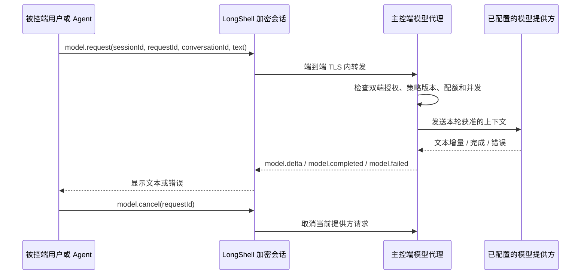

# 主控端专属能力反向调用与模型会话可行性评估

评估日期：2026-10-27  
状态：仅完成方案评估，尚未实现、构建或部署。

## 结论

LongShell 当前的数据通道足以承载受限的“被控端请求主控端专属能力、主控端执行、结果返回被控端”反向调用。已有认证后的端到端 TLS 通道、会话 ID、序号、动态策略版本和取消机制，可作为传输与授权的基础。Relay 只需继续转发加密帧，不应接触请求正文或结果。

产品层目前不具备通用反向调用：MCP 服务注册的是连接/远程工具、对话状态/同步工具和安全提示；没有主控端能力目录、反向请求路由或对应授权。模型会话是这类反向调用中的一个具体能力；项目没有模型提供方、模型请求队列或模型凭证管理。远程协议的消息白名单也没有反向业务请求类型。现有 `ConversationStore` 是显式同步的 JSONL 对话记录，不是模型客户端，不能直接当成模型代理。

首版建议由主控端上的模型提供方适配器处理请求。适配器可以连接主控端配置的云 API 或本机模型服务；凭证仅留在主控端。不要把远程 MCP 客户端对模型采样能力当作首版依赖：OpenAI 的公开 Codex/MCP 文档说明 Codex 可连接 MCP 服务器、MCP 服务器可向客户端提供工具，但没有承诺 Codex 主动响应服务器发起的模型采样请求。该兼容性须由实际客户端能力协商和端到端试验确认。[Codex MCP 文档](https://developers.openai.com/learn/docs-mcp) [MCP 服务器快速入门](https://developers.openai.com/plugins/build/app-quickstart)

## 术语与边界

“主控端专属能力反向调用”指：被控端用户或被控端上的获准 Agent 发起一个具名、参数受限的请求；主控端执行本机登记的能力，再经原 LongShell 会话返回结果。它不是在被控端执行主控端程序，也不是把任意主控端本机工具开放给远端。

“被控端主动调用主控端模型进行会话”是上述能力的一个特例：主控端作为模型宿主处理请求。现有主控端 Agent 通过 MCP 调用被控端工具的方向已经存在；新增方向是被控端请求主控端能力。两个方向的权限、数据边界和并发必须分开。

## 路线比较

| 路线 | 可行性 | 限制 | 建议 |
| --- | --- | --- | --- |
| 具名的主控端专属能力反向调用 | 高 | 每个能力都要有独立 schema、权限、并发/资源约束和撤销路径；不能暴露通用本机执行接口 | 做成受限能力注册表；首版只注册模型文本生成 |
| 主控端模型提供方适配器 | 高 | 需主控端配置模型地址/凭证、超时和预算；API 调用可能产生费用 | 首版采用。允许云 API 或主控端本机模型，共用一个窄接口 |
| 借用当前 MCP/Codex 客户端的模型 | 未确认 | 依赖 MCP 客户端是否支持服务器发起的模型请求、用户审批和异步关联；公开 Codex 文档未作此兼容承诺 | 只做后续实验，不作为产品可用性前提 |

“主控端模型”需要先区分为“在主控电脑运行的模型服务/API”与“主控端 Codex 当前对话正在使用的模型”。前者可以由 LongShell 自己的适配器管理；后者属于 AI 客户端宿主能力，不能仅凭已经配置了 MCP 工具就视为可调用，也不等同于 OpenAI API 账户/计费凭证。

## 建议的数据流

请求和响应都绑定当前 `sessionId`、双方认证身份、能力 ID、`requestId`、会话策略版本和单调递增序号。主控端只路由到静态登记且 schema 校验通过的能力处理器。断线、会话关闭、权限撤销或策略版本变化时，主控端取消在途请求；新连接不得自动续跑旧请求。

## 首版权限和产品行为

1. 增加独立的能力授权，例如“允许请求主控端模型”，不复用 `CommandExecute`、`SessionRead` 或自动批准工具开关。
2. 采用双边启用：被控端明确允许本会话请求该能力；主控端明确启用相应处理器、选择模型配置并设定用量上限。任一方关闭即停止新请求并取消在途请求。
3. 连接后不自动上传对话、不自动启动会话。每次由被控端用户或 Agent 明确发起；主控端 UI 显示来源身份、请求内容、目标模型和当前状态，并允许取消。
4. MVP 的能力注册表只放入模型文本生成，并只返回文本；不提供模型工具调用，不让被控端借模型绕过 LongShell 的远程命令权限，也不让模型侧继续调用被控端工具。后续新增其他主控端能力时逐个评估，禁止通用 shell、任意本机路径访问和透传 MCP 工具。
5. 首版不持久化提示词和响应。已有对话同步存储继续保持显式 opt-in，不能因启用模型代理而自动打开。
6. 主控端模型配置和凭证仅保存在主控端的受保护存储中，永不进入被控端配置、Relay 请求、发布二进制或安装日志。

建议首版单会话最多一个在途模型请求，设置输入/输出长度上限、提供方超时、每会话请求速率和总量上限。具体额度应在产品设定后定值；超限须返回明确错误，不能静默降级为其他模型。

## 实现工作量与顺序

这项功能可拆成三个可独立验证的增量：

1. **能力注册与模型提供方抽象**：在主控端建立静态能力注册表和文本生成接口、配置状态、凭证保护、超时和取消；先连本机 mock/本机模型，不接入远程协议。
2. **单轮反向请求**：增加严格白名单的能力请求/完成/失败/取消协议帧、独立权限位、身份和代次校验；先做有界非流式请求，禁止工具调用和历史记录。
3. **交互式流式会话**：增加 token/text 增量、背压、断线取消、UI 状态和配额；再以本机模型或可控测试提供方做双端验证。

第一阶段不需要更改云端 Relay 的业务协议；若现有 Relay 对帧大小或吞吐量限制阻止流式请求，再单独评估 Relay 约束。部署仍必须维持 `NewServer/server.json` 的 Alibaba Cloud 目标，当前明确不进行服务器部署。

## 当前代码差距

- `ProtocolJson.AllowedTypes` 没有模型请求、增量、完成、失败或取消帧。
- 被控端命令会话目前处理主控端发来的命令与工具请求；没有发起主控端业务请求的入口。
- 主控端 broker 没有模型请求的反向结果路由；本地 MCP 初始化只注册连接适配器、对话状态/同步工具和提示。
- 权限枚举和策略更新中没有模型访问权限；现有授权不应被解释为模型调用授权。
- 当前 MCP 运行于 stdio；当前项目没有模型 API 凭证存储或 provider 实现。

## 未决产品选择

- “主控端模型”首版是云 API、主控端本机模型，还是两者都支持？建议先提供一个 provider，验证接口后再加第二种。
- 远程 Agent 发起请求时，主控端是否需要逐次人工确认？建议首次启用时确认一次，并在 UI 持续显示远程请求和累计用量；可由主控端设置为每次确认。
- 是否需要多轮上下文？建议让调用方传入受限的当前会话上下文；LongShell 不默认存储历史。
- 被控端是否需要通过 MCP 暴露“请求主控端模型”工具？建议在桌面 UI 单轮链路先稳定后再开放，避免无 UI 用户在后台持续触发费用。

