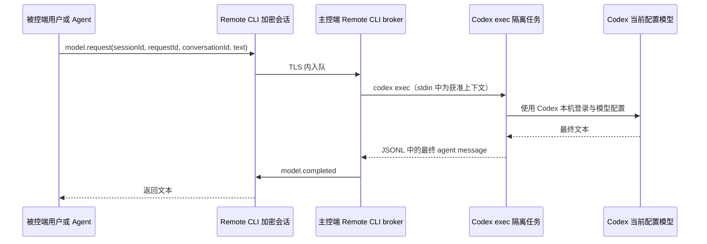
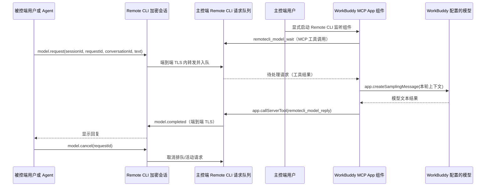

# 主控端专属能力反向调用与模型会话可行性评估

评估日期：2026-10-27  
状态：Codex exec 本地原型、主控端对话 UI 和 Codex CLI 路径设置已完成 Windows x64 测试构建；Relay `20261027-143730` 已部署，公网合成探针通过；真实双端登录和模型调用尚未验证。

## 结论

Remote CLI 当前的数据通道足以承载受限的“被控端请求主控端专属能力、主控端执行、结果返回被控端”反向调用。已有认证后的端到端 TLS 通道、会话 ID、序号、动态策略版本和取消机制，可作为传输与授权的基础。Relay 只需继续转发加密帧，不应接触请求正文或结果。

产品层仍不具备通用能力目录或任意反向调用；本轮只实现模型文本会话这一具名能力，使用独立权限与协议帧，经当前端到端会话请求主控端处理。Remote CLI 不保存模型凭证；本机 broker 启动 Codex CLI，并只在内存保留有界会话上下文。现有 `ConversationStore` 仍是显式同步的 JSONL 对话记录，不是模型客户端，不能直接当成模型代理。

结合“借用现有客户端模型”的目标，可以复用 WorkBuddy，也可以复用 Codex CLI 的登录态和模型配置，两者都不要求 Remote CLI 保存模型 API 凭证。WorkBuddy Enterprise 的 MCP Apps 接入文档明确列出 `app.createSamplingMessage`，用途是让 host 按自身模型配置生成一次结果；同一 guest API 还提供 `app.callServerTool`，可将结果回传原 MCP Server。[WorkBuddy Enterprise MCP Apps 接入](https://cloud.tencent.cn/document/product/1831/137044)

WorkBuddy 的 MCP Apps 路线适合已有活动 widget 的交互场景，但不能保证唤醒空闲客户端。Codex CLI 没有文档承诺 MCP Server 可直接请求当前模型，不过 OpenAI 提供稳定的非交互式 `codex exec`，适合由主控端 Remote CLI 在收到远程请求时按需启动一个独立模型任务。因此，如果需求是“被控端发起后即使没有打开 Codex TUI 也能处理”，Codex `exec` 是当前文档支持更完整的候选；它复用 CLI 账户与配置，但不会自动接续用户正打开的 TUI 对话。[Codex MCP 文档](https://learn.chatgpt.com/docs/extend/mcp) [Codex 非交互模式](https://learn.chatgpt.com/docs/non-interactive-mode)

## 术语与边界

“主控端专属能力反向调用”指：被控端用户或被控端上的获准 Agent 发起一个具名、参数受限的请求；主控端执行本机登记的能力，再经原 Remote CLI 会话返回结果。它不是在被控端执行主控端程序，也不是把任意主控端本机工具开放给远端。

“被控端主动调用主控端模型进行会话”是上述能力的一个特例：主控端作为模型宿主处理请求。现有主控端 Agent 通过 MCP 调用被控端工具的方向已经存在；新增方向是被控端请求主控端能力。两个方向的权限、数据边界和并发必须分开。

## 路线比较

| 路线 | 可行性 | 限制 | 建议 |
| --- | --- | --- | --- |
| 具名的主控端专属能力反向调用 | 高 | 每个能力都要有独立 schema、权限、并发/资源约束和撤销路径；不能暴露通用本机执行接口 | 做成受限能力注册表；首版只注册模型文本生成 |
| WorkBuddy MCP Apps 组件请求宿主模型 | 高（文档确认 WorkBuddy Enterprise host 接口） | 需要宿主支持 MCP Apps、打开对应组件，并处理组件调用 MCP 工具的授权；宿主空闲时没有已确认的唤醒机制 | 适合用户已打开监听组件的交互路线；用 `app.createSamplingMessage` 生成并经 `app.callServerTool` 回传 |
| 已启动的 WorkBuddy Agent 通过普通 MCP 工具轮询/回复 | 中高 | 需要 Agent 主动保持监听；不能靠普通 MCP Server 工具调用保证唤醒一个空闲客户端 | 可作为不支持 MCP Apps 的兼容路线；每轮请求/回复均使用具名工具 |
| Codex CLI 直接 MCP sampling 回调 | 未确认 | Codex 支持 MCP 工具，但官方支持列表没有列出 server-to-client sampling；不能当作已支持的回调 API | 不依赖此路线 |
| Remote CLI 按请求启动 `codex exec` | 高 | 是独立 Codex 执行会话，不是当前 TUI 对话；需本机 CLI、有效登录和严格隔离的运行配置 | 已实现本地原型；主控端收到请求后启动临时非交互任务并收取最终文本 |
| 普通 stdio MCP Server 直接请求 host sampling | 未确认 | WorkBuddy 通用 MCP 文档未承诺此能力，须以实际客户端协商结果验证 | 不作为首版前提 |
| 主控端模型提供方适配器 | 高 | 需要额外配置模型 API/本机服务和凭证，偏离“复用现有客户端模型”的目标 | 仅作为所选客户端路线不可用时的后备 |

### Codex CLI 的具体路线

Codex CLI 官方文档确认 Codex CLI 可配置 STDIO MCP Server，且 Codex CLI、桌面端和 IDE 扩展共享 MCP 配置；Codex 会把 MCP 工具提供给 Agent。文档中的“Supported MCP features”没有列出 `sampling/createMessage` 或服务端主动回调模型，因此直接由 Remote CLI MCP Server 请求 Codex 当前模型应判为未确认，而不是已支持。[Codex MCP 文档](https://learn.chatgpt.com/docs/extend/mcp)

可用的正式入口是 `codex exec`：它支持脚本/CI 非交互运行、从 stdin 接收上下文、输出 JSONL 事件，并可结束后通过 session ID 恢复。Codex CLI 可使用 ChatGPT 账户认证，也支持 API Key；若目标是复用 ChatGPT 登录，Remote CLI 仅调用本机 Codex CLI，不读取或传递其认证文件。[非交互模式](https://learn.chatgpt.com/docs/non-interactive-mode) [CLI 命令参考](https://learn.chatgpt.com/docs/cli/reference)

当前原型由控制端 broker 将受限的本轮文本经 stdin 交给本机 `codex exec --ephemeral --json`，使用独立空临时工作目录和 `longshell-temporary` permissions profile，配置只允许读取临时目录与 Codex 最小运行路径、拒绝其余文件访问并禁用模型工具网络，再将最终 agent message 经原 Remote CLI TLS 会话返回。profile 通过 `--config` 内联配置并启用 `--strict-config`；不传 `--sandbox`，因为该参数会使 Codex 改用旧 sandbox 配置而忽略 permissions profile。官方 CLI 文档确认 `--ephemeral` 不持久化 session rollout 文件、stdin 可接收 prompt，`--json` 输出 JSONL 事件；不过本机登录、profile 解析和真实模型调用尚未实机验证。[Codex 非交互模式](https://learn.chatgpt.com/docs/non-interactive-mode) [CLI 命令参考](https://learn.chatgpt.com/docs/developer-commands?surface=cli) [权限 profiles](https://learn.chatgpt.com/docs/permissions)

为避免远端文本驱动本机操作，首版不向该运行开放其他 MCP Server，使用专用空工作目录和只读 permissions profile，并限制文件、网络和可用工具。桥接层直接收取最终文本后经 Remote CLI 会话回传，不让模型再调用被控端工具。多轮上下文由 Remote CLI 有界地保存在内存并显式传入；如果改为 Codex `resume` 复用内部对话状态，就要接受 Codex 保存该执行会话记录。Codex `--json` 会输出包括工具调用和 agent 消息在内的 JSONL 事件，桥接层应只转发最终文本，不转发本机执行日志。[非交互模式](https://learn.chatgpt.com/docs/non-interactive-mode)

这会复用 Codex CLI 的已登录模型能力，但创建的是独立 exec 会话；它不是向用户当前打开的 Codex TUI 注入消息，也不会自动共享当前 TUI 历史。主控端连接页提供路径输入、浏览选择和自动查找；自动查找先读 Codex 桌面配置 `CODEX_CLI_PATH`（`%CODEX_HOME%\config.toml` 或 `%USERPROFILE%\.codex\config.toml`），再检查官方默认安装目录 `%LOCALAPPDATA%\Programs\OpenAI\Codex\bin\codex.exe`。Relay 只接收去掉 `ControllerModelUse` 的兼容元数据，实际权限仍由认证握手提出并经主控端审批。Codex CLI 仍需在主控端安装并完成登录，真实执行尚待实机验证。

Codex 路线的数据流：

## 建议的数据流

请求和响应都绑定当前 `sessionId`、双方认证身份、能力 ID、`requestId`、会话策略版本和单调递增序号。主控端只路由到静态登记且 schema 校验通过的能力处理器。WorkBuddy widget 通过 MCP 工具取任务并一次性回传结果；这样不需要按 token 反复调用可能弹授权框的 `app.callServerTool`。断线、会话关闭、权限撤销或策略版本变化时，主控端取消排队和活动请求；新连接不得自动续跑旧请求。

## 首版权限和产品行为

1. 已增加独立的“允许请求主控端模型”权限，不复用 `CommandExecute`、`SessionRead` 或自动批准工具开关。
2. 采用双边启用：被控端明确允许本会话请求该能力；主控端选择并启用 WorkBuddy 监听组件或 Codex exec 桥接，任一方关闭即停止新请求并取消在途请求。
3. 连接后不自动上传历史对话。每次由被控端用户明确发起；主控端连接前单独同意，并可撤权取消进行中的任务。WorkBuddy 路线需要用户打开监听组件；Codex 路线由 Remote CLI 在收到请求后启动非交互任务，但要求 CLI 已登录并通过受限配置运行。
4. 被控端提交给主控端的内容会发送给所选客户端的模型，需在主控端明确启用。MVP 只生成文本，不开放模型工具调用。WorkBuddy 路线使用 `app.createSamplingMessage`，不要把远端原文通过 `app.sendMessage` 注入权限更广的一般主对话；Codex 路线使用独立的只读 exec 配置，不向其暴露其他 MCP Server。模型侧均不得继续调用被控端工具。后续新增其他主控端能力时逐个评估，禁止通用 shell、任意本机路径访问和透传 MCP 工具。
5. 首版不持久化提示词和响应。已有对话同步存储继续保持显式 opt-in，不能因启用模型代理而自动打开。
6. WorkBuddy/Codex 登录态和模型配置留在各自客户端管理的本地存储中；Remote CLI 不读取凭证，也不把它们传给被控端、Relay、发布二进制或安装日志。

建议首版单会话最多一个在途模型请求，设置输入/输出长度上限、提供方超时、每会话请求速率和总量上限。具体额度应在产品设定后定值；超限须返回明确错误，不能静默降级为其他模型。

## 实现工作量与顺序

Codex exec 本地原型已接入；本地构建和既有测试已完成，剩余工作如下：

1. 在用户控制的主控端与被控端桌面会话中验证双方授权、Codex CLI 登录状态、permissions profile 解析、最终消息解析、多轮内存上下文和撤权/断线取消。
2. 在用户控制的双端桌面会话中验证当前阿里云 Relay 的完整连接流程和 Codex 临时会话。部署后的公网合成验证已确认 `SessionRead | ControllerModelUse` 邀请注册返回 HTTP 202，并通过 WSS/TLS 加密往返。
3. WorkBuddy MCP Apps 仍是单独的后续适配路线，当前代码没有实现其 widget sampling。

该原型增加了独立权限位。为兼容尚未升级的 Relay，客户端邀请注册请求会屏蔽该可选权限位；实际请求仍由被控端认证握手提出，主控端审批后通过现有端到端会话授权。Relay 不需要解析模型请求内容。`20261027-143730` 已部署到 `NewServer/server.json` 指定的 Alibaba Cloud 目标；公开端点接受包含该权限位的合成邀请并返回 HTTP 202。真实 Remote CLI 双端会话仍待用户控制的桌面验证。

## 当前代码差距

- 本地代码已加入受限的 `controller.model.request/result` 协议帧和独立 `ControllerModelUse` 权限；没有增量流、模型工具调用、MCP 入口或单独取消帧。
- 被控端桌面 UI 已加入明确发起入口；每次连接仍需主控端单独同意。权限撤销和断线会取消活动调用。
- 主控端连接成功且双方授权后显示本机 Codex 对话面板，参考 `design/chat-empty.html`；本机聊天与被控端反向请求共享 provider 和总请求限额，但使用相互隔离的内存上下文。
- 主控端连接页可手动指定 `codex.exe`、通过原生文件选择器浏览，或自动查找；自动查找优先使用 Codex 桌面配置 `CODEX_CLI_PATH`，然后检查官方默认安装目录 `%LOCALAPPDATA%\Programs\OpenAI\Codex\bin\codex.exe`。手动选择路径仅存于当前用户的 `%LOCALAPPDATA%\Remote CLI\codex-cli.json`，不存储认证凭证。
- Relay 邀请与用户名授权注册统一只发送兼容的权限元数据；`ControllerModelUse` 仍保留在端点认证握手和实时策略中。云端访问日志确认 `/v1/authorizations` 曾返回 HTTP 400，但旧桌面版没有保留响应错误码，不能从访问日志判定具体拒绝原因；当前客户端会显示 Relay 返回的安全错误码。
- 主控端 broker 已调用本机 `codex exec --ephemeral --json`，只解析最终 agent message；调用使用 `--ignore-user-config`、`--ignore-rules`、`--strict-config`、禁止审批、空临时工作目录和 `longshell-temporary` permissions profile（只允许读取临时目录与最小运行路径，拒绝其余文件访问，关闭模型工具网络）。不传 `--sandbox`，以免切换到旧 sandbox 配置而绕过 profile。该配置尚未在真实模型调用中验证。
- Remote CLI 在当前加密会话内维护最多 8 轮、最多 16 KiB 的临时上下文；每会话最多 20 次调用，单次请求上限 8 KiB、结果上限 12 KiB，执行超时 60 秒。断线或撤权后清除上下文。
- Remote CLI MCP 当前是 stdio 工具服务，没有 MCP Apps widget resource、主控端反向请求队列或 WorkBuddy host sampling 桥接。
- 尚未在真实双端会话中验证 Codex 登录、permissions profile 解析和完整 JSONL 响应；Remote CLI 不读取或复制 Codex 凭证。若配置文件和官方默认路径都不存在，可在主控端连接页指定 `codex.exe`。
- 当前阿里云 Relay 为 `20261027-143730`；公网健康检查、两种合成授权模式和 `ControllerModelUse` 邀请注册均通过，真实 Remote CLI 桌面会话和模型调用仍未测试。
- 当前项目不保存模型 API 凭证，也没有直接调用模型 API 的 provider；模型请求复用 WorkBuddy/Codex 客户端自身管理的能力与登录态。

## 未决产品选择

- 用户安装的是支持 MCP Apps `createSamplingMessage` 的 WorkBuddy Enterprise/CodeBuddy 版本，还是只支持普通 MCP 工具的 WorkBuddy 客户端？需在实际客户端上核实版本和 host 能力。
- WorkBuddy Agent/组件是否需要一直保持活动，才能接收远端主动发起的请求？目前资料未确认空闲唤醒能力，建议首版要求显式启动监听。
- WorkBuddy 侧是否每次都要弹窗批准 widget 对 `remotecli_model_reply` 的 `app.callServerTool` 调用？官方说明默认有授权弹窗，可结合实际设置验证；回复按整轮一次调用以避免逐 token 审批。
- 主控端选择的 Codex CLI 是否已通过 ChatGPT 账户登录，并允许 Remote CLI 服务进程调用 `codex exec`？需在受限原型中验证，不读取或复制 `auth.json`。
- Codex `exec` 桥接选用每轮 `--ephemeral` 并由 Remote CLI 内存维护上下文，还是使用 `codex exec resume` 保存会话？建议首版选前者，避免持久化远程会话内容。
- 是否需要多轮上下文？建议让调用方传入受限的当前会话上下文；Remote CLI 不默认存储历史。
- 被控端是否需要通过 MCP 暴露“请求主控端模型”工具？建议先由被控端 UI/明确调用发起，待权限和配额验证后再开放给 Agent。

